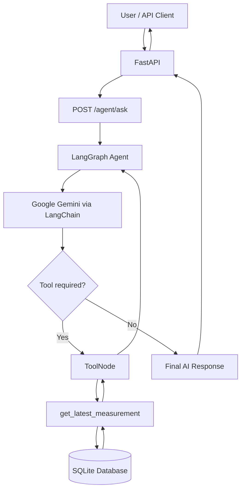

# Enterprise AI Operations Agent

An AI-powered industrial monitoring prototype that combines **LLM reasoning, tool calling, and structured sensor data** to help users retrieve and interpret equipment measurements through natural-language questions.

## Project Overview

Industrial monitoring systems generate large amounts of equipment and sensor data. Accessing this information typically requires navigating dashboards, querying databases, or interacting with specialized software.

This project explores how an AI agent can simplify access to operational data by translating natural-language questions into controlled tool calls against a sensor database.

The current prototype allows users to ask questions such as:

> "What is the latest temperature recorded by GAS-101?"

The AI agent identifies the appropriate tool, retrieves the measurement from SQLite, and generates a natural-language answer using the returned data.

The system combines a **FastAPI backend, SQLite database, LangChain, LangGraph, and Google Gemini**.

The project is being developed incrementally, with a focus on modular architecture, automated testing, and practical AI engineering principles.

## Current Features

- **REST API:** FastAPI endpoints for managing equipment and sensor measurements.
- **Persistent storage:** SQLite database for equipment and measurement records.
- **Data validation:** Pydantic models for validating API requests and sensor data.
- **LLM integration:** Google Gemini accessed through LangChain.
- **AI function calling:** The LLM can select a Python tool and provide structured arguments.
- **LangGraph agent:** A stateful workflow that automatically routes tool requests, executes tools, and returns results to the LLM.
- **Database retrieval:** A tool for retrieving the latest measurement of a specified equipment ID.
- **Natural-language interface:** `POST /agent/ask` allows users to query sensor measurements through the AI agent.
- **Automated testing:** 15 passing pytest tests, including an isolated API test that does not require LLM API calls.

## System Architecture

The application combines a REST API, a LangGraph-based AI agent, and a SQLite database.



### Agent Execution Flow

1. A user submits a natural-language question through the FastAPI endpoint.
2. LangGraph sends the conversation to Gemini.
3. Gemini determines whether a database tool is required.
4. If a tool is requested, LangGraph executes it using `ToolNode`.
5. The tool retrieves the relevant measurement from SQLite.
6. LangGraph returns the tool result to Gemini.
7. Gemini generates a final answer grounded in the retrieved data.
8. FastAPI returns the answer as a JSON response.

The agent uses controlled Python tools rather than allowing the LLM to execute arbitrary SQL queries.

## Tech Stack

| Technology | Role |
|---|---|
| Python 3.12 | Main programming language |
| FastAPI | REST API backend |
| Pydantic | Data validation and API schemas |
| SQLite | Persistent storage for equipment and sensor measurements |
| LangChain | LLM integration and tool definitions |
| LangGraph | Stateful agent orchestration and conditional tool execution |
| Google Gemini | Language model for reasoning and tool selection |
| pytest | Automated testing |
| Git & GitHub | Version control and project documentation |

The current implementation uses Gemini through Google's API free tier, subject to provider availability and usage limits.

## Getting Started

### Prerequisites

- Python 3.12
- Git
- A Google Gemini API key with access to a supported model

### Installation

Clone the repository:

```bash
git clone https://github.com/Noufel-Hub/enterprise-ai-operations-agent.git
cd enterprise-ai-operations-agent
```

Create a virtual environment:

```bash
python -m venv .venv
```

Activate it on Windows (PowerShell):

```powershell
.\.venv\Scripts\Activate.ps1
```

Install the dependencies:

```bash
python -m pip install -r requirements.txt
```

### Environment Configuration

Create a `.env` file in the project root:

```dotenv
GOOGLE_API_KEY=your_gemini_api_key_here
```

The `.env` file is excluded from Git through `.gitignore`.

**Never commit API keys or other credentials to GitHub.**

### Database Setup

The application uses a local SQLite database named `operations.db`.

Initialize the database and populate it with synthetic equipment and sensor measurements:

```powershell
python -m scripts.seed_database
```

The script:
- Creates the required database tables if they do not exist.
- Inserts sample equipment and measurement records.
- Avoids duplicating sample records when executed multiple times.
- Preserves existing database records.

The database file is excluded from Git through `.gitignore`.

After initialization, the API and AI agent can retrieve the sample measurements.

### Run the API

Start the FastAPI development server:

```bash
python -m uvicorn src.main:app --reload
```

Open the interactive API documentation:

http://127.0.0.1:8000/docs

### Example Agent Request

Use the `POST /agent/ask` endpoint with:

```json
{
  "question": "What is the latest temperature recorded by GAS-101? Use the available tool."
}
```

Example response:

```json
{
  "answer": "The latest temperature recorded by GAS-101 is 28.5°C."
}
```

The response depends on the measurements stored in SQLite and may vary in wording.

**Note:** Agent requests use the Gemini API and are subject to the selected model's availability and usage quotas.

## Testing

The project uses **pytest** to validate API behavior, data validation, and application functionality.

Run the test suite from the project root:

```bash
python -m pytest -v
```

The current test suite contains **15 passing tests**, including an isolated test of the AI agent endpoint.

The agent endpoint test uses mocking to avoid making real Gemini API calls. This makes the test reproducible without consuming API quota.

### Testing Strategy

- Validate successful API requests and expected responses.
- Verify Pydantic input validation and HTTP error handling.
- Test equipment and measurement API functionality.
- Mock external LLM dependencies in automated API tests.
- Extend coverage as new agent tools and workflows are introduced.

Further testing will include agent evaluation, tool-call correctness, and response grounding.

## Development Roadmap

The project is being developed incrementally, from a working backend to a more complete AI-powered industrial operations platform.

### Phase 1 — Backend and Data Foundation
- [x] Create FastAPI application
- [x] Implement equipment and measurement endpoints
- [x] Add Pydantic data validation
- [x] Integrate SQLite persistence
- [x] Implement automated API tests
- [x] Add reproducible database initialization and sample data

### Phase 2 — LLM and AI Agent
- [x] Integrate Google Gemini through LangChain
- [x] Implement a database retrieval tool
- [x] Implement LLM function calling
- [x] Build a LangGraph agent with conditional tool execution
- [x] Expose the agent through FastAPI
- [x] Add a mocked agent endpoint test
- [ ] Add more operational analysis tools
- [ ] Implement structured error handling
- [ ] Evaluate tool selection and response grounding

### Phase 3 — Knowledge Retrieval and Advanced Workflows
- [ ] Implement retrieval-augmented generation (RAG)
- [ ] Integrate technical procedures and documentation
- [ ] Build multi-step incident investigation workflows
- [ ] Add human-in-the-loop approval for sensitive actions

### Phase 4 — Engineering and Deployment
- [ ] Add Docker containerization
- [ ] Implement GitHub Actions CI/CD
- [ ] Deploy the application to AWS
- [ ] Implement logging and monitoring
- [ ] Add authentication and authorization
- [ ] Strengthen security and AI governance

## Project Status

**Working prototype — under active development.**

The current application supports natural-language retrieval of sensor measurements through a LangGraph agent connected to SQLite.

Advanced incident investigation, RAG, production deployment, and operational monitoring are planned capabilities.